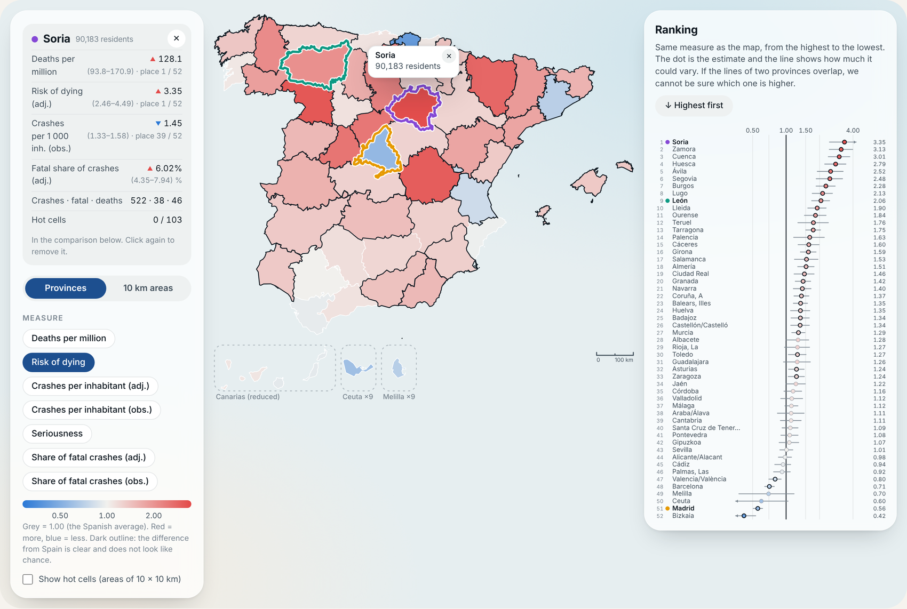
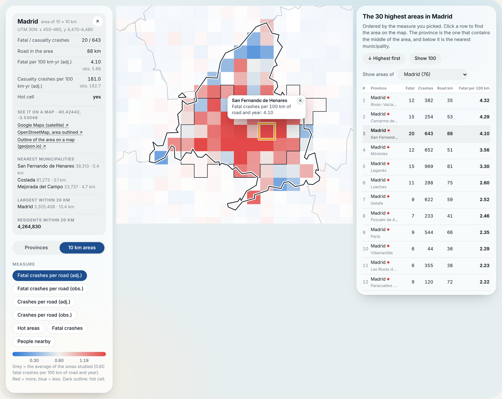

# road-risk-ranking-spain

Ranking of road crash risk in Spain **with uncertainty**: Bayesian provincial models, 2-km road segments and 10 km grid cells, validated out of sample on DGT crash microdata, 2022–2025. Reproducible notebook and interactive atlas (Spanish / English).

### → [Open the interactive atlas](https://MMH1997.github.io/road-risk-atlas-spain/)

> **Resumen.** Los rankings de provincias y de tramos por muertes parten de recuentos pequeños, así que las diferencias entre unidades reflejan tanto el azar como el riesgo. Este repositorio contiene el cuaderno que reproduce el análisis (404 809 accidentes con víctimas y 7 112 fallecidos a 30 días, 2022–2025) y un atlas interactivo bilingüe para lectores no especialistas.

<p align="center">
  
  
</p>

## What is in here

| Path | Content |
|---|---|
| [`notebooks/road_risk_analysis.ipynb`](notebooks/road_risk_analysis.ipynb) | The whole analysis, from the raw DGT files to the tables and figures of the paper. Outputs are stripped; run it to regenerate them. |
| [`docs/index.html`](docs/index.html) | The interactive atlas: one self-contained file (~1 MB). The public copy, served on the web, is in [road-risk-atlas-spain](https://github.com/MMH1997/road-risk-atlas-spain). |
| [`atlas/`](atlas) | The atlas template and data (`src/`) and the scripts that build it and regenerate its data. |
| [`data/`](data) | Where the input files go (not versioned) and how to obtain each one. |
| [`results/dgt_tables.xlsx`](results/dgt_tables.xlsx) | The aggregated tables of the paper (one sheet per table), exactly as the notebook wrote them in the run reported in the paper. Aggregates only; no individual crash. |
| [`outputs/`](outputs) | Where the notebook writes tables, figures, caches and the reproducibility manifest (not versioned). |

## The analysis in brief

The notebook is organised in numbered sections; the main questions are:

1. **Years** – exact rate ratios, calendar standardisation, a Kitagawa composition/rate decomposition and a quasi-Poisson trend.
2. **Provinces** – empirical-Bayes shrinkage and funnel plots for case fatality; risk per inhabitant split into frequency, severity and deaths per fatal crash.
3. **Hierarchical Bayesian models (BYM2, PyMC + nutpie)** for severity, frequency and risk, with a rank interval and the probability of being among the ten highest for each of the 52 provincial units. Province-grouped cross-validation tests whether borrowing strength from neighbours helps.
4. **Sites** – crashes located from road code and kilometre point; 2-km segments and 10 km cells; Getis–Ord Gi\* with false-discovery-rate control; forward-in-time evaluation and regression to the mean.
5. **Reviewer-proofing analyses (Section 12)** – empirical-Bayes scores for segments, baseline rankings for cells, the spatial test repeated for frequency and risk, a point-in-province check of the geocoding, and heterogeneity checks (road users, lighting, late deaths).

### Main results

- Spain registers **36.6 deaths per million inhabitant-years**. The risk is highest in sparsely populated inland provinces (**Soria 128.1, 3.5 times the national rate**), and the excess comes mostly from the severity of crashes and not from their number.
- Hot cells of 10 × 10 km concentrate around the large metropolitan areas and on the Mediterranean and Andalusian coast, and they **persist**: cells detected with earlier years have **4.0 to 4.5 times** the rate of the other cells in the following year.
- Segments selected for one or two fatal crashes lose **85 % to 88 %** of them in the following year (regression to the mean).
- Smoothing fatal counts helps only when it borrows information from casualty crashes, and **a plain count of casualty crashes ranks segments and cells as well as the model-based and Gi\* rankings** in the validation.
- Spatial smoothing across neighbouring provinces improves the prediction of **frequency**, is indistinguishable from independent effects for **severity**, and is worse for **risk**.

See the paper for the full results and their limits. The crash files contain no alcohol, drug or speed variables, so the notebook does not test explanations that depend on them.

## Atlas

[`docs/index.html`](docs/index.html) is a single static file: it needs no server and no download of data, and it works on a phone. It has a province view (seven measures, a comparison table and five supporting panels) and an area view of the 10 km cells (seven measures, a ranking of the highest areas, nearby municipalities and links to open each cell on a map). No individual crash is included: the finest detail is the count of a 10 km cell.

### How to open it

The atlas is published at **[https://MMH1997.github.io/road-risk-atlas-spain/](https://MMH1997.github.io/road-risk-atlas-spain/)** from its own public repository, [road-risk-atlas-spain](https://github.com/MMH1997/road-risk-atlas-spain), so that this repository can stay private until the paper is published. GitHub shows `index.html` as source code, not as a page, so to see the map either use that address or download `docs/index.html` and open it in a browser (it works offline except for two web fonts and the map links).

When the atlas changes, rebuild it (below) and copy `docs/index.html` to the public repository.

To rebuild it after changing the template or the data:

```bash
python atlas/build_atlas.py          # writes docs/index.html
```

To regenerate the data from a new run of the notebook, see [`atlas/prep/README.md`](atlas/prep/README.md).

## Quick start

```bash
git clone https://github.com/MMH1997/road-risk-ranking-spain.git
cd road-risk-ranking-spain

# environment (Python 3.11 or 3.12 recommended)
conda env create -f environment.yml && conda activate road-risk
#   or: python -m venv .venv && source .venv/bin/activate && pip install -r requirements.txt

# put the input files in data/raw/ (see data/README.md), then
jupyter lab notebooks/road_risk_analysis.ipynb
```

The notebook reads the folders from the environment variables `DGT_DATA_DIR` (default `../data/raw`) and `DGT_OUT_DIR` (default `../outputs`). A single seed (42) drives every stochastic step. The first read of each Excel workbook is slow; it is cached afterwards.

**Running time.** Sections 8–9 (MCMC) and the province-grouped cross-validation of Section 12 dominate. Each can be switched off in the configuration cell (`RUN_BAYES`, `RUN_KFOLD`, `RUN_ML`, …) while you work on the rest.

**Known pitfalls.**

- *NumPy 2 with older pandas/pyarrow builds* raises an `ImportError` at import time. Use the pinned environment, or upgrade `pandas`, `pyarrow` and `numexpr` together.
- *ArviZ 0.x versus 1.x* have different `az.summary` arguments (`hdi_prob` versus `ci_prob`). The notebook patches this in the Section 8 import cell.

## Data

The raw data are public and are **not** redistributed here; see [`data/README.md`](data/README.md) for what to download and where from. The notebook writes a `manifest.json` with the SHA-256 of every input file and the versions of the libraries, so that any reported number can be traced to its inputs.

## Citation

If you use this code or the atlas, please cite the paper (reference to be added when it is published) and this repository. GitHub's "Cite this repository" button gives the format (see [`CITATION.cff`](CITATION.cff)).

## License

MIT, © 2026 Manuel Méndez ([`LICENSE`](LICENSE)): the copyright notice must be kept, and a citation as above is requested. Third-party data keep their own terms: the atlas embeds municipality names and populations from the SoftLine Spanish geographic database and administrative boundaries from IGN/CNIG (CC BY 4.0, attribution required).

## Authors and acknowledgements

Manuel Méndez, Design and Testing of Reliable Systems Research Group, Complutense University of Madrid.

This work was supported by the State Research Agency (AEI) of the Spanish Ministry of Science and Innovation under grant PID2025-168053OB-I00 (NEXUS), and by the Comunidad de Madrid under grant TEC-2024/COM-235 (DESAFíO-CM).
